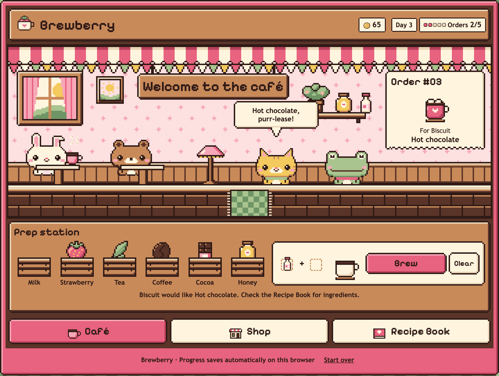
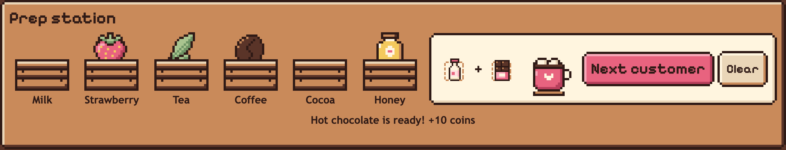
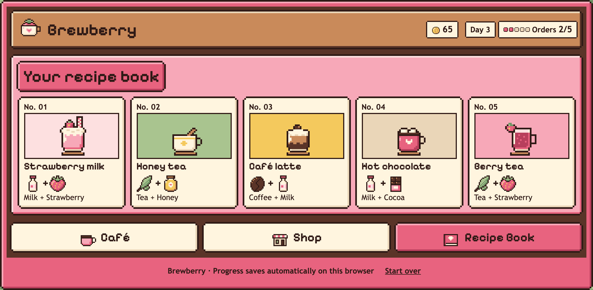
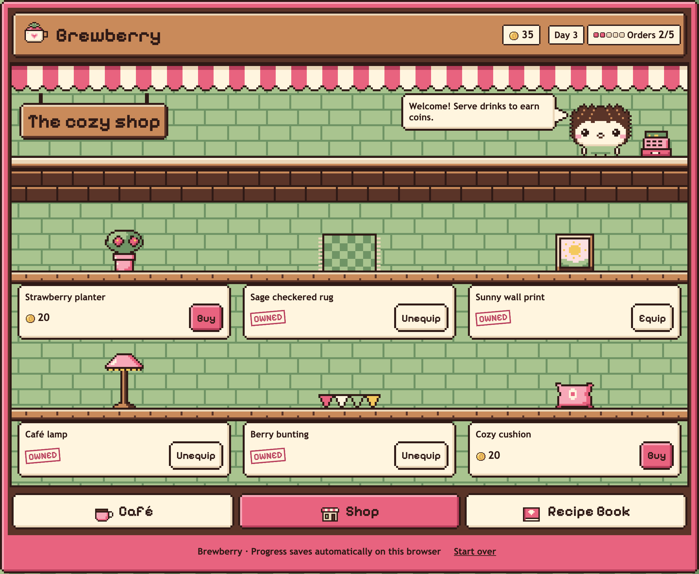
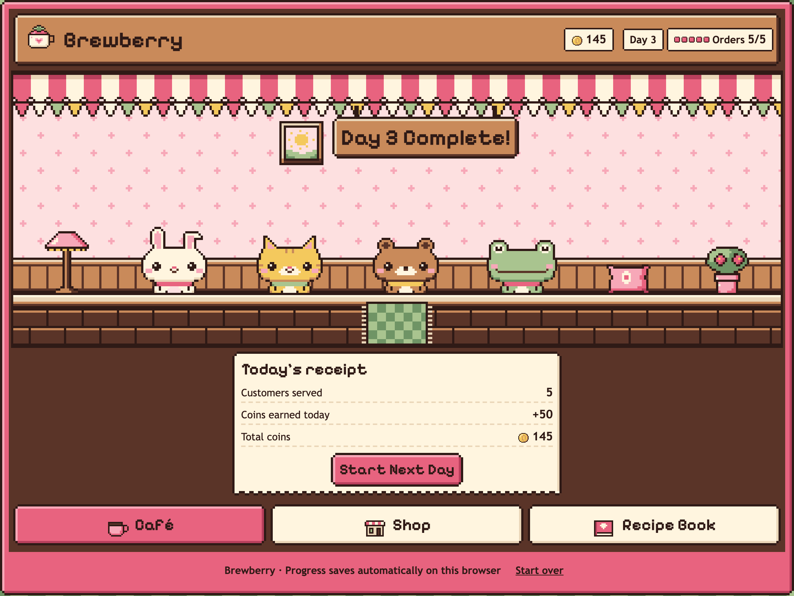
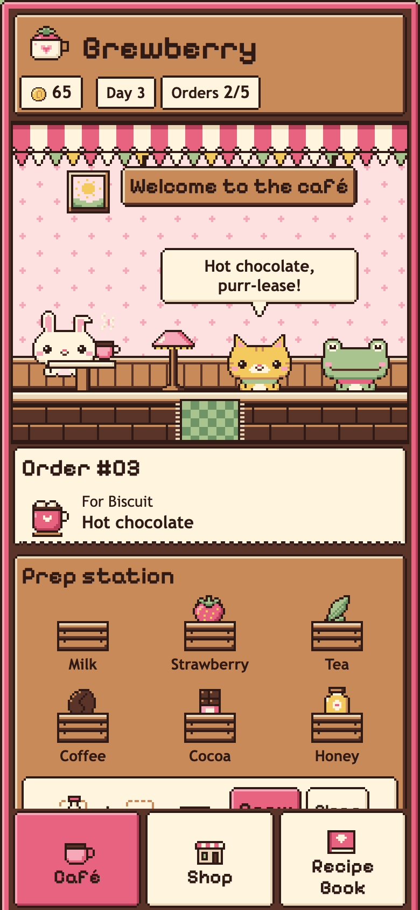
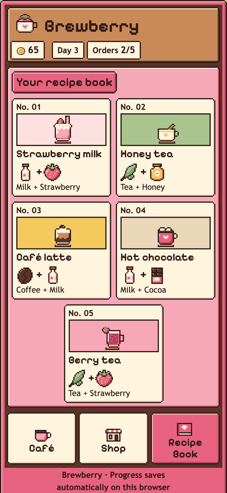

# Brewberry

A cozy pixel-art café game for the browser. Take orders from four animal regulars, look up recipes, brew drinks, earn coins, and decorate your café, one relaxed in-game day at a time.



**Live demo:** coming soon.

Built with React, TypeScript, Vite, Tailwind CSS, and Vitest. All artwork is original pixel art, generated from editable text grids.

## Features

- **Four animal customers.** Mochi the bunny, Biscuit the cat, Maple the bear, and Matcha the frog, each with their own sprite and lines.
- **Brewing without pressure.** Combine two of six ingredients to make five drinks. There are no timers, and a wrong drink just gets a friendly hint and another try.
- **A collectible Recipe Book.** Every drink as an illustrated card.
- **Coins and a shop.** Earn 10 coins per drink and spend them on six decorations from a hedgehog shopkeeper. Equip or put them away at any time.
- **In-game days.** Five orders make a day, ending with a receipt of what you earned. Days are unlimited.
- **Automatic saving.** Progress saves in the browser after every action, with no account or server.
- **Keyboard, screen reader, and mobile support.** Every screen is playable with a keyboard, from 320px phones to desktops.

## Screenshots

| Brewing | Recipe Book |
| --- | --- |
|  |  |
| **Shop** | **Day Complete** |
|  |  |

<p align="center">
  
  &nbsp;&nbsp;
  
</p>

## How to play

1. Read the order ticket. It names the drink but not its ingredients.
2. Check the Recipe Book if you need to. Your selected ingredients stay put, and coming back takes you straight to the Prep station.
3. Pick two ingredient crates, in any order, then select **Brew**.
4. A correct drink earns 10 coins. Select **Next customer** when you're ready.
5. After five orders, select **Finish Day**, then **Start Next Day**.
6. Spend coins in the Shop. Decorations appear in the café straight away.

## Technical highlights

- **Predictable game state.** All rules live in one reducer ([`src/data/cafeGame.ts`](src/data/cafeGame.ts)). State holds only IDs and numbers, so it saves as plain JSON.
- **Safe, validated saves.** Saves are versioned and validated on load, and an unreadable save is kept as a backup instead of being deleted. The reducer pays for a served drink once and refuses to sell a decoration twice, so refreshing can't repeat a reward or purchase. A revision number on each save detects conflicting writes.
- **One active tab.** The Web Locks API and BroadcastChannel ensure only one browser tab plays and saves at a time, with a safe "Play here instead" handover between tabs.
- **Clear handling of storage problems.** If saving fails, is blocked, or can't be made safe, the game keeps playing and shows a persistent warning rather than silently losing progress.
- **A dependency-free art pipeline.** A small Node script turns text-grid sprites into PNGs, a typed manifest, and the favicon.
- **Tested thoroughly.** 397 unit and integration tests, covering gameplay, saving edge cases, multi-tab handovers, and keyboard focus. Release checks also ran in Firefox and Chromium.

Implementation details are in [docs/DEVELOPMENT.md](docs/DEVELOPMENT.md).

## Accessibility

- Every control works with the keyboard. Switching screens moves focus to the new screen's heading.
- Order results, coin balances, and shop messages are announced through live status messages.
- Buttons and tabs have touch targets of at least 44px. The layout works from 320px wide upward.
- Animations stop when the system asks for reduced motion.
- All text meets WCAG AA contrast, measured on the rendered pixel art in Firefox and Chromium.

**Known limitations:**

- Not yet tested with screen readers (VoiceOver, NVDA, or TalkBack). Announcements have been checked in code only.
- Buttons for decorations you can't afford are disabled, so the Tab key skips them. Their "Need X more coins" note is still read in screen-reader browse mode.
- On macOS, Firefox and Safari skip links, including **Skip to content**, when tabbing, unless the system's Keyboard navigation setting is on.
- Start over uses the browser's built-in confirmation dialog.
- On narrow screens, a few decorations are hidden from the café and Day Complete scenes for everyone.

## Saving and browser support

Brewberry is built for current desktop and mobile browsers. Release testing covered Firefox and Chromium-based browsers. Safari hasn't been tested yet. Progress saves to `localStorage`, so:

- Saves belong to one browser on one device, and private windows clear them when closed.
- Browsers may clear saved data for sites you haven't visited in a while, Safari especially.
- **Saving needs HTTPS or `localhost`.** Over plain HTTP, such as a phone testing `npm run dev -- --host` over a local network, browsers turn off the Web Locks API. The game still plays, but it shows a warning and saves nothing.

## Getting started

Requires Node.js 24 (see `.nvmrc`) and npm.

```bash
git clone https://github.com/arielle-amercadel/brewberry.git
cd brewberry
npm ci
npm run dev
```

Then open the local URL Vite prints, usually http://localhost:5173.

| Command | Purpose |
| --- | --- |
| `npm run dev` | Start the development server |
| `npm run test:run` | Run all tests once (`npm test` for watch mode) |
| `npm run lint` | Run ESLint |
| `npm run build` | Type-check and build for production into `dist/` |
| `npm run preview` | Serve the production build locally |
| `npm run sprites` | Regenerate sprites from `art/sprites/` |

## Deployment

Brewberry is a static site with no server, environment variables, or routing. On Vercel, import the repository and keep the detected **Vite** preset (build command `npm run build`, output directory `dist`). The `engines` field in `package.json` selects Node 24.

## Project structure

```text
art/              Editable sprite grids and palette (the source for all pixel art)
docs/             Development notes and screenshots
scripts/          Sprite generator
src/
  components/     Header, navigation, prep station, sprites, decorations
  data/           Game rules, recipes, customers, saving, and tab locking
  hooks/          Repeated key press guard
  views/          Café, Shop, Recipe Book, Day Complete, and tab notices
  App.tsx         Game state, saving, and screen switching
```

## How it was built

I built Brewberry over seven days, with each feature on its own Git branch, merged through a pull request. I designed the game and set the scope and priorities for each day. Implementation and automated testing were done with AI assistance from Claude (Anthropic) under my direction. Before merging, each branch was reviewed independently by OpenAI Codex, and I tested features by hand in the browser.

## License

[MIT](LICENSE) © 2026 Arielle Mercadel. The bundled Pixelify Sans font is licensed separately under the SIL Open Font License 1.1 (see [`src/assets/fonts/OFL.txt`](src/assets/fonts/OFL.txt)).
